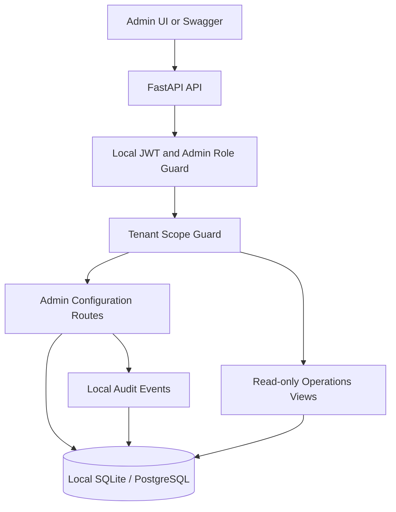

# ClaimSpire Admin backend — architecture and scope

## The purpose of the Admin product surface

Admin configures and **observes** the operating environment. It is not where a claimant reports loss, a field adjuster captures evidence, or a desk adjuster adjudicates coverage. It presents selected operational summaries and authorizes configuration changes without taking ownership of the claims domain.

## Source-led foundation versus intentionally assumed features

**Supported by supplied SOW and persona materials:** four product surfaces, multi-tenancy, 16 canonical personas, an internal Platform Ops Admin UI for Ask ClaimSpire governance, kill switches, prompt/model controls, AI Use Case Register and operational governance; initial managed tenant setup; RBAC + ABAC; audit; control-plane features; the broad FNOL→desk→field→QA→finance→resolution claim flow.

**Assumed for the runnable demo:** tenant/user CRUD Admin pages, local JWT login, mock workflow templates, simplified feature flags, basic integration-health entries, synthetic claim-stage reports, dispatch/QA/finance panels, local relational audit history, the exact endpoint routes, all ID formats, the role-permission shortcut (Platform Ops = all demo tenants; Tenant IT Admin = own tenant).

**Not implemented or implied by the prototype:** production Cognito/PDP, Amazon Bedrock, AWS AppConfig, real workflow state machine, assignment scoring, field sync, package sealing, genuine human QA, claim financial approvals, multi-tenant RLS, legal hold, regulator-grade audit, zero-trust service authorization, actual payments, real integration traffic, full self-service tenant admin.

## Local service diagram

## UI modules and ownership

| Category | UI module | Local data source | Future owner in ClaimSpire architecture |
|---|---|---|---|
| Management | Tenants / users / personas | `tenants`, `users`, `roles` | Identity / Governance / managed onboarding |
| Configuration | LOB / workflow templates | `lines_of_business`, `workflow_templates` | Claim Core / Workflow configuration |
| Controls | Feature flags / AI register | `feature_flags`, `ai_use_cases` | Governance / AppConfig / AI Gateway |
| Observability | Claims / dispatch / QA / finance | `claims`, `assignments`, `qa_reviews`, `financial_items` | Separate domain services; **read-only** |
| Integration status | External integration register | `integrations` | Integration Fabric/Catalog |
| Audit | Admin change history | `audit_events` | Audit & Timeline Service |

The separate data tables in this local repo are convenience demo projections. They are **not** a recommendation to duplicate each owning production service's database.

## Local authentication + tenancy

- All Admin endpoints require an authenticated user with `PLATFORM_OPS` or `TENANT_IT_ADMIN`.
- `PLATFORM_OPS` can view all demo tenants and create a new demo tenant. `TENANT_IT_ADMIN` sees only their tenant and cannot modify operating model or lifecycle status.
- All tenant-bound list and detail routes enforce the tenant scope in the backend. A caller-supplied `tenant_id` cannot bypass scope checks.
- The 16 canonical persona entries are **definitions**, not 16 separate local Admin accounts.
- The production rules for actions/permissions still require the ClaimSpire-approved RBAC/ABAC/SoD matrix. Local rules are intentionally generic.

## Demo data and what the dashboard means

Each of two demo tenants is populated with 8 independent synthetic claims. Each is given one of these simplified display stages: `FNOL`, `TRIAGE`, `DESK`, `DISPATCH`, `FIELD`, `QA`, `FINANCE`, `CLOSED`. Those fields let an Admin dashboard show progress and counts; they do **not** enforce a linear state machine or imply every real claim must visit every stage. Real ClaimSpire processes include parallel and conditional branches.

`GET /admin/workflow-stages` supplies a stable list of stages with counts; `GET /admin/dashboard/summary` supplies the cards and status breakdowns.

## Production integration seam (future, not needed locally)

Replace mock DB projections with authorized, read-only domain queries; replace local auth/role guard with Cognito + PDP; replace local flags with AppConfig; AI governance views with AI Gateway service APIs; local audit with append-only Audit & Timeline; local infra with project-approved deployment services. Keep route-level contracts stable where practical, and apply production authorization again at the owning service.
