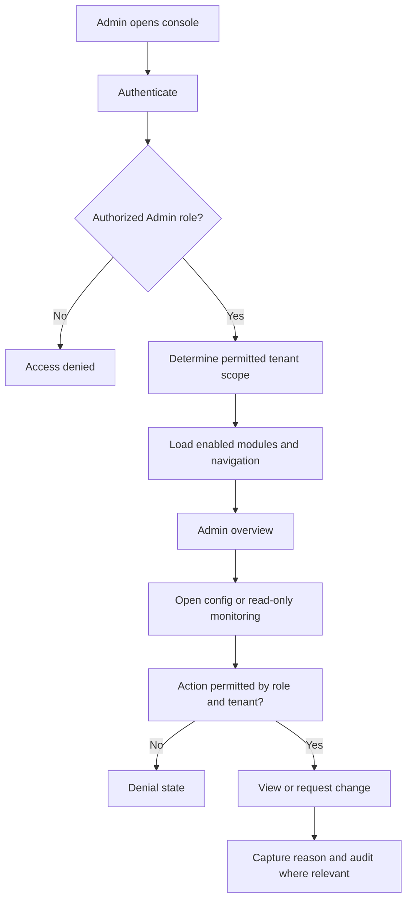

# End-to-End Admin Product Surface — Proposed Journeys

The following workflows are **proposed Admin UI journeys**, not approved end-to-end client business workflows. They align to project context without pretending to implement Claim Core, dispatch execution, inspection QA decisions, or financial disbursement.

## A. Entry and operating context



**Why:** Every Admin operation must be understood in the context of *who* is acting and *which tenant/resource* they are allowed to see. The demo uses local JWT and two example Admin roles; production requires Cognito/PDP and approved RBAC/ABAC.

## B. Tenant activation / organization setup

**Actor:** ClaimSpire Platform Operations (managed activation), with appropriate client inputs. **Product intent:** make a customer's initial operating environment ready.

```text
Initial tenant profile → operating model and Lines of Business
→ users and persona assignments → access-policy/authority approvals
→ allowed feature bundles and AI governance settings
→ first-wave integration readiness → operational checks / audit → go-live readiness
```

**Demo actions:** view tenants; create a synthetic tenant (Platform Ops only); edit tenant display name; view LOBs; create a synthetic user and assign a persona; browse demo workflow templates and feature flags.

**Does not mean:** production self-service tenant creation, dynamic infrastructure provisioning, or claiming approved permission mappings.

## C. AI/feature switch governance (most explicit signed Admin use case)

**Actor:** Authorized platform/tenant administrator as defined by approved policy. **Trigger:** operational need to inspect or change a controlled capability.

```text
Select tenant/scope → inspect current switch + effective state
→ select desired change → provide reason → authorization/approval checks
→ apply through configured control plane → verify actual effective state
→ persist request/outcome audit → show UI confirmation/history
```

**Demo today:** local feature and AI use-case flags change in SQLite; changes are reason-coded and appended to a local audit table. **Production later:** integrate AppConfig and AI Gateway, version pinning, deployment/propagation reporting, authorized emergency kill-switch flow, central Audit Ledger.

**Why:** This is the closest demonstration to explicit Internal Admin UI requirements while remaining runnable without AWS.

## D. User and persona administration

**Actor:** Authorized admin within permitted tenant scope.

```text
Select permitted tenant → list users → view persona catalogue
→ add or update user (demo) → validate role and status
→ reject forbidden privilege escalation or cross-tenant operation
→ write audit entry → updated directory
```

**Important:** 16 personas are canonical business roles, not automatically a signed action-level access matrix. The demo grants Admin entry to Platform Ops and Tenant IT Admin only.

## E. Workflow and operations visibility

**Actor:** Admin/operations viewer; **purpose:** understand system and workload state, not perform desk adjuster's job.

```text
Overview → claim lifecycle stage counts
→ inspect read-only claims → inspect field assignment status
→ inspect QA-package status → inspect finance item status
→ return to operational overview or audit
```

The underlying *business* sequence is FNOL → claim creation → triage → desk investigation → field dispatch (if required) → inspection → package review/QA → carrier evaluation → finance → resolution. Some steps are conditional or parallel; the Admin stage list is a simplified visualization, not an executable decision engine.

## F. Integration configuration visibility

```text
View first-wave integration inventory → review category/status/owner
→ identify missing setup evidence → hand off to integration owner
```

Demo status records are static/synthetic and do not test any provider or store credentials.

## G. Audit and support investigation

```text
Admin performs config/user action → action gets actor, tenant and timestamp
→ audit record appended → auditor or authorized admin searches history
→ sees reason, before/after when recorded → investigates independently
```

Production remains governed by the immutable Audit & Timeline Service, legal hold, retention and redaction rules.

## H. Deliberately excluded from the Demo Admin

- Creating live claims or replacing FNOL intake service.
- Dispatching actual field personnel or overriding adjuster certifications.
- Approving inspection packages / making QA decisions.
- Making binding coverage decisions, issuing claim denials or processing actual payments.
- Generative AI, live carrier/accounting integration or AWS resource provisioning.
- Full tenant self-service onboarding or advanced Admin modules not explicitly approved.

These are owned by their business services, future features, or unresolved sign-offs. The Admin experience can *observe* permitted status and *govern* permitted configuration without assuming their responsibilities.
