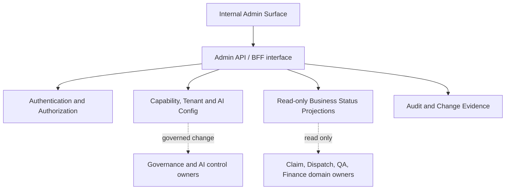

# Admin Architecture: Prototype Today, Production-Aligned Tomorrow

## Intended Admin responsibilities

**Admin owns configuration orchestration, governance visibility and safe operational control.** It does **not** own the canonical claim, FNOL execution, field evidence, QA decisions or financial postings.



### Local demonstration implementation

```text
Browser (http://127.0.0.1:8000/demo)
  -> FastAPI static UI + /api/v1/*
       -> Local JWT and tenant/role checks
       -> Routers: auth / tenants / people / configuration / operations / audit / readiness
       -> SQLAlchemy (SQLite local file)
       -> Synthetic sample data
```

Every demo configuration mutation is explicit and audited locally. Business records are read-only. There are no external/network calls to a live insurer, AI model, payment provider or AWS system.

### Production architecture alignment (not included locally)

```text
Browser → Edge/API Gateway → Cognito + PDP
   → approved Admin/Governance/AI Gateway APIs
   → authoritative service/configuration sources
   → append-only Audit & Timeline / operational events
```

**Decision pending:** whether the logical Admin API layer should be a deployable FastAPI BFF or whether the functions should live directly in existing Governance and AI services. The prototype uses a modular BFF-friendly structure and can be split by owning service after the architecture decision.

## Draft source-of-truth ownership

| Resource | Demo store | Production owner per SOW design | Notes |
|---|---|---|---|
| Tenant profile | SQLite | Managed tenant configuration / governance | No full self-service required |
| User record | SQLite | Cognito identity + Governance persona mapping | Don't handle production credentials in Admin DB |
| Role / authority | SQLite demo role code | Governance/PDP | Final P-07/P-08 matrix required |
| Feature flag | SQLite bool | AppConfig/configuration control plane | Real effective-state propagation matters |
| AI use case | SQLite catalog | AI Gateway/governance registry | CHK mapping, approved model/prompt controls |
| Workflow stage list | SQLite JSON | Workflow Engine (if configured) | Demonstration only; no executable gate semantics |
| Claims, field, QA, finance | SQLite summaries | Claim Core / Assignment / Field / Finance services | Read-only metadata projections |
| Audit | SQLite records | Audit & Timeline append-only service | Demo audit isn't tamper-proof |

## API rules for production-ready contracts

- Versioned REST endpoints, stable opaque IDs, request/response DTOs and consistent error codes.
- Deny by default; check authenticated actor and target tenant/resource at every route.
- Distinguish *authorized*, *requested*, *pending approval*, *pending apply*, *effective*, *failed* configuration states.
- Require meaningful reason codes and suitable authorization for privileged changes; avoid blind boolean toggles in production.
- Reject stale updates using version checks (e.g. ETag/If-Match), preserve audit evidence.
- Store credentials in supported secret management and keep them out of response payloads.
- Enforce domain boundaries; never allow Admin to write direct finance or claim-state tables.
- Negative tests for other-tenant read/write, privilege escalation, disabled actors and disallowed fields.

## Proposed error / edge-case tests

| Trigger | Expected behavior |
|---|---|
| No bearer token | 401 |
| Business persona calling Admin | 403 |
| Tenant admin accessing other tenant | 403 |
| Tenant admin changing operating model | 403 in current demo |
| Invalid flag change reason | 422 |
| Duplicate tenant slug | 409 |
| Attempt to mutate read-only claims | 405 |
| AppConfig apply request fails (future) | Audit failure + UI not claiming effective state |
| Concurrent config version conflict (future) | 409 / 412 and reload state |
| Workflow QA/financial actions (future) | Routed only through owner-domain permissions and approved workflows |

## Non-goals for first prototype

No DDD microservice implementation, AWS integration, true workflow execution, model inference, payment release, SMS/email delivery, mobile capture or production-grade identity. The first deliverable focuses on **product and API shape**, integration points and demonstrable safe data operations.
